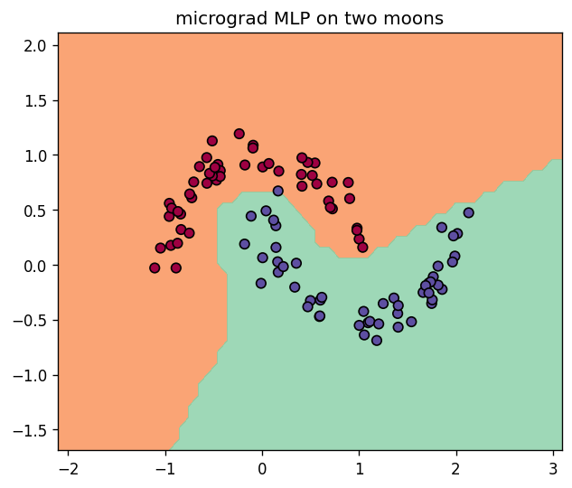
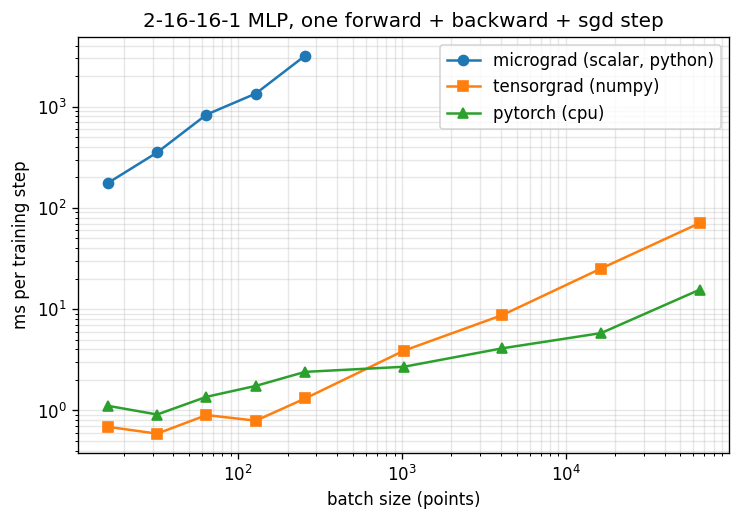
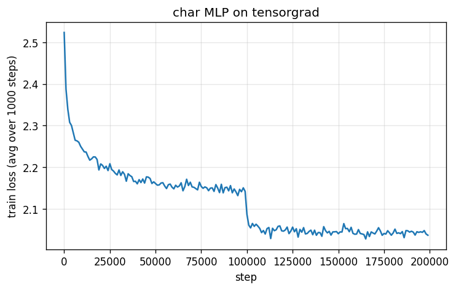
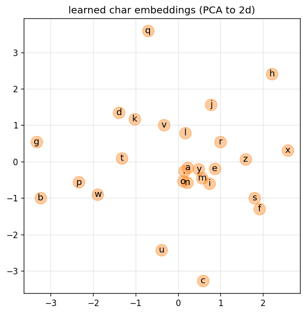
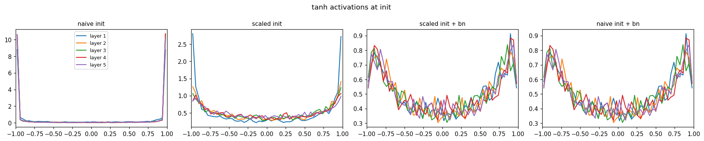
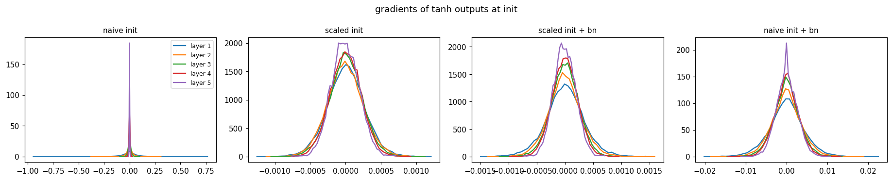
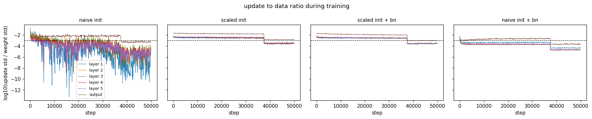
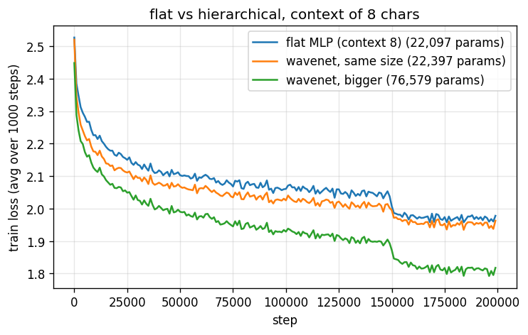

# llm-foundations-systems

[](https://github.com/Rushil-Nair/llm-foundations-systems/actions/workflows/tests.yml)

Implementation of a GPT-style Large Language Model from scratch, focusing on the intersection of Transformer architecture and training efficiency. Built to understand the lower-level mechanics of autograd engines and tensor operations.

## Setup

```
pip install -r requirements.txt
```

numpy is the only real dependency. pytorch is used as a reference, to check gradients in the tests and as a baseline in the benchmarks. CI runs the micrograd and tensorgrad tests plus the manual-vs-autograd gradient check on every push.

## Progress

- [x] **micrograd** - scalar autograd engine + a small MLP trained on two moons (`micrograd/`)
- [x] **tensorgrad** - the same engine rebuilt on numpy arrays, benchmarked against micrograd and pytorch (`tensorgrad/`)
- [x] **makemore** - bigram (counting + neural) and Bengio-style MLP character models, trained on tensorgrad, no pytorch (`makemore/`)
- [x] **activations, gradients, batchnorm** - 5-layer tanh MLP under 4 init / batchnorm setups with activation, gradient and update diagnostics (`makemore/deep_mlp.py`)
- [x] **backprop by hand** - every gradient of the batchnorm MLP derived manually and matched against autograd, fused batchnorm op in tensorgrad (`makemore/backprop_ninja.py`)
- [x] **wavenet** - hierarchical model that merges context pairwise (8 -> 4 -> 2 -> 1), val 1.9925 (`makemore/wavenet.py`)
- [ ] triton kernels for the hot ops (matmul, softmax, fused cross-entropy)

## micrograd

```
cd micrograd
python test_engine.py   # gradients vs finite differences and pytorch
python train.py         # trains a 2-16-16-1 MLP, saves decision_boundary.png
```



## tensorgrad

micrograd tracks every single number as its own python object, so one training step on 256 points builds a graph of ~160k nodes. tensorgrad keeps the same design (each op stores a `_backward`, topological sort, chain rule) but every node is a whole numpy array.

What's in it:
- ops: `+ - * / **`, `exp log tanh relu`, `@`, `sum mean max` (with `axis`/`keepdims`), `reshape transpose`, indexing (for embedding lookups later)
- broadcasting-aware backward: gradients get summed back down to the input's shape (`_unbroadcast`)
- `cross_entropy` as a single fused op: backward is just `(softmax - onehot) / n` instead of going through the softmax graph
- `Linear`, `ReLU`, `Sequential`, `MLP`, `SGD`
- every op tested against pytorch in float64 plus a finite difference check

```
cd tensorgrad
python test_tensor.py       # all ops vs pytorch
python train.py             # two moons, same setup as micrograd
python bench_vs_scalar.py   # micrograd vs tensorgrad vs pytorch
```

### Benchmark

Same 2-16-16-1 MLP, one training step (forward + backward + SGD update), median of several runs. Laptop CPU (i7-9750H), numpy 1.26, torch 2.6.

| batch size | micrograd (ms/step) | tensorgrad (ms/step) | pytorch cpu (ms/step) | tensorgrad vs micrograd |
|---:|---:|---:|---:|---:|
| 16 | 175.7 | 0.689 | 1.1 | 255x |
| 32 | 352.3 | 0.590 | 0.911 | 598x |
| 64 | 832.5 | 0.900 | 1.4 | 925x |
| 128 | 1343.7 | 0.792 | 1.7 | 1,696x |
| 256 | 3178.5 | 1.3 | 2.4 | 2,422x |
| 1,024 | - | 3.9 | 2.7 | - |
| 4,096 | - | 8.7 | 4.1 | - |
| 16,384 | - | 25.2 | 5.8 | - |
| 65,536 | - | 70.7 | 15.6 | - |



Takeaways:
- micrograd's cost grows linearly with batch size since every element is a python object. tensorgrad's time barely moves until ~256 points because at that size it's dominated by fixed per-op overhead, not math.
- tensorgrad is actually *faster* than pytorch at small batches. pytorch pays more per op (dispatcher, autograd bookkeeping), and at tiny sizes that overhead is the whole cost.
- past ~1k points pytorch pulls ahead (~4.5x at 65k). numpy runs each elementwise op single-threaded and writes a full intermediate array to memory for every op (`1 - y*s`, `relu`, `mean` are 3 separate passes), while pytorch uses multiple threads and better kernels. that memory traffic between ops is exactly what kernel fusion removes, which is the next step with triton.

## makemore

Character-level language models on the names dataset (32k names, `makemore/names.txt` from karpathy/makemore). Everything trains on tensorgrad. Split is 80/10/10 on whole names.

```
cd makemore
python bigram_counts.py   # count bigrams, sample, saves bigram_counts.png
python bigram_nn.py       # same model learned by gradient descent
python mlp.py             # 3-char context MLP, ~100s on a laptop CPU
```

| model | params | train loss | val loss |
|---|---:|---:|---:|
| uniform guess | 0 | 3.296 | 3.296 |
| bigram, counting (add-one smoothing) | 729 | 2.455 | 2.453 |
| bigram, gradient descent | 729 | 2.463 | 2.461 |
| MLP (context 3, embd 10, hidden 200) | 11,897 | 2.039 | **2.105** |

MLP test loss: 2.105. 200k steps, batch 32, lr 0.1 then 0.01, ~0.5 ms/step on tensorgrad (100-110s total on an i7-9750H).

Samples from the MLP:

```
kaiyan  calani  dime  victan  asaia  samari  navyn  keyla  desia  keilyanleigh
```





Notes:
- The neural bigram is just a 27x27 table of logits, so it can't do better than counting. Gradient descent lands almost on the counted probabilities (max difference 0.048); the small gap comes from the L2 term, which plays the role of smoothing.
- `onehot(x) @ W` is the same as picking row `x` of `W`, so the bigram and the MLP's embedding table both use indexing instead of a one-hot matmul. The backward for indexing is a scatter-add (`np.add.at`) so repeated characters accumulate their gradients.
- Init matters: tanh layer scaled by `(5/3) / sqrt(fan_in)` and a near-zero output layer. That way the loss at init is 3.30, the same as uniform guessing, instead of starting around 20+, and val loss ends at 2.105 compared to ~2.17 with plain random init in the lecture.
- The embeddings learn structure nobody told them about: in the PCA plot the vowels `a e i o y` cluster together, and rare letters like `q` sit off on their own.
- Two tensorgrad optimizations that didn't work. Profiling the neural bigram (full batch, 182k rows) showed most of each step going to the cross-entropy and the scatter-add in backward.
  - Replacing `np.add.at` with a sort + `np.add.reduceat` scatter was *slower* (77ms vs 54ms per call). `np.add.at` got a fast path in numpy 1.25.
  - Caching the softmax from the forward pass so `exp` only runs once looked like a 24% win on whole training runs, but that was run-to-run noise (the same code ranged from 70s to 112s on this laptop). Timed in isolation with interleaved runs it was 12% *slower*, because the backward needs a copy of the cached array anyway and with only 27 columns `exp` is cheap. Lesson: microbenchmark the op itself, not the whole training loop.

## activations, gradients and batchnorm

`makemore/deep_mlp.py` trains a deeper model (embedding -> 5 x [linear 100 -> tanh] -> linear 27) four ways and looks inside it. New tensorgrad layers for this: `BatchNorm1d` (train/eval modes, running stats), `Tanh`, `Embedding`, `Flatten`, all checked against pytorch in `tensorgrad/test_layers.py`.

```
cd makemore
python deep_mlp.py              # all 4 setups, 50k steps each, ~8 min
python deep_mlp.py --steps 2000 # quick run
```

50k steps each, batch 32, lr 0.1 then 0.01 for the last quarter:

| setup | params | loss at init | tanh saturated at init (layer 1 / 5) | train | val | ms/step |
|---|---:|---:|---:|---:|---:|---:|
| naive init (all weights N(0,1)) | 46,497 | 20.77 | 68% / 82% | 2.725 | 2.719 | 1.00 |
| scaled init ((5/3)/sqrt(fan_in), small output layer) | 46,497 | 3.61 | 19% / 5% | 2.024 | **2.099** | 1.11 |
| scaled init + batchnorm | 46,997 | 3.57 | 3% / 3% | 2.072 | 2.109 | 4.06 |
| naive init + batchnorm | 46,997 | 13.68 | 3% / 3% | 2.185 | 2.194 | 4.00 |

The batchnorm ms/step here is from before batchnorm was fused into one op. With the fused version (now the default) the same "scaled init + bn" step takes 2.16 ms instead of 5.22 ms, see the backprop section below.

"Saturated" = |tanh| > 0.97, where the local gradient `1 - tanh^2` is < 0.06 and almost nothing flows back.







What the plots show:
- **naive init**: pre-activations are huge, so 70-80% of tanh units sit at ±1 from step 0. Their gradients are ~0 with a few huge outliers, the update/data ratio swings over 10 orders of magnitude, and it ends at val 2.72, worse than the bigram.
- **scaled init** fixes it by itself: activations spread over (-1, 1), gradients look similar in every layer, updates sit around 10^-2.5 of the weights. Best result, 2.099 val, slightly better than the 1-hidden-layer MLP (2.105).
- **batchnorm makes the hidden layer init irrelevant in the forward pass**: the activation histograms for "scaled + bn" and "naive + bn" are identical, because BN divides out whatever scale the previous linear layer has.
- ...but **not in the backward pass**. With BN, scaling W up by k scales dL/dW down by k, so the relative update shrinks by k^2. With N(0,1) weights (k = 3-6x bigger than the scaled init) theory says 10-36x smaller relative updates. Measured: ~10-15x lower (~10^-3.6 vs ~10^-2.5), and the model learns slower: 2.19 vs 2.11 val. BN rescues a bad init from collapsing, it doesn't make it free.
- At this depth with a good init, BN doesn't help the final loss (2.109 vs 2.099). Its batch statistics add some noise, and it costs ~4x per step here because it adds ~10 small ops per layer, each paying python + numpy call overhead. Fusing it into one op with a hand-written backward (like `cross_entropy`) is the obvious fix, done in the next section.

Perf note: the first version of this ran at 6-12 ms/step. Profiling showed nearly all of it in `(32,100) @ (100,100)` matmuls taking ~300us each. OpenBLAS defaults to one thread per core, and for matrices this small the thread sync overhead dominates:

| matmul shape (float32) | 12 threads (default) | 4 threads | 1 thread |
|---|---:|---:|---:|
| (32,30) @ (30,100) | 6.2 us | 8.2 us | 7.6 us |
| (32,100) @ (100,100) | 312.8 us | 91.4 us | **17.9 us** |
| (512,100) @ (100,100) | 386.8 us | 175.9 us | **132.7 us** |
| (4096,256) @ (256,256) | 5,248 us | **4,872 us** | 7,816 us |

So `deep_mlp.py` sets `OPENBLAS_NUM_THREADS=1` before importing numpy, which took the no-batchnorm runs from ~6 ms to ~1 ms per step. Threads only start paying off once the matrices get big.

## backprop by hand

`makemore/backprop_ninja.py` takes the MLP (embedding -> linear -> batchnorm -> tanh -> linear) and breaks the forward pass into 26 single-op steps, then writes the backward for each one manually in numpy. Everything is checked against tensorgrad's autograd in float64:

```
cd makemore
python backprop_ninja.py               # gradient checks + 100k steps of training, ~3 min
python backprop_ninja.py --steps 2000  # quick run
```

- **exercise 1**: all 26 manual gradients (`logprobs` back to the embedding table `C`) match autograd **exactly**, bit for bit, since they do the same numpy ops in the same order.
- **exercise 2**: cross-entropy backward in one line, `(softmax(logits) - onehot(y)) / n`. Max difference vs the step-by-step version: 1e-17.
- **exercise 3**: batchnorm backward in one line. Max difference: 2e-18.
- **exercise 4**: train 100k steps using only the one-line formulas, no autograd. It ends at train 2.1634 / val 2.1802, identical to 4 decimals to the same model trained through tensorgrad, which is a good end-to-end check that the fused batchnorm below is right. The manual version is only 1.1-1.3x faster per step, so tensorgrad's graph overhead is small now.

The batchnorm backward is the interesting one. Each input affects the output directly, through the batch mean, and through the batch variance, and adding up the three paths gives

```
dx = invstd / n * (n * dxhat - sum(dxhat) - xhat * sum(dxhat * xhat))      where dxhat = gamma * dout
```

The `logit_maxes` gradient comes out at ~1e-17: subtracting the row max only shifts the logits, which doesn't change the softmax, so it shouldn't matter, and it doesn't.

### fused batchnorm in tensorgrad

That formula is now `tensor.batchnorm`, a single graph node, and `BatchNorm1d` uses it by default (`fused=False` gives back the version built from ~10 primitive ops). Tests check it against pytorch and against the composite version, and they fail if any of the three terms is dropped. `tensorgrad/bench_batchnorm.py`, best of interleaved runs:

| batchnorm forward + backward (B, D) | composite (us) | fused (us) | speedup |
|---|---:|---:|---:|
| (32, 100) | 534.5 | 182.2 | 2.9x |
| (256, 100) | 1337.7 | 692.0 | 1.9x |
| (4096, 100) | 26586.6 | 19036.6 | 1.4x |
| (32, 1024) | 1681.0 | 822.0 | 2.0x |

| deep_mlp training step (5 bn layers, batch 32) | composite (ms) | fused (ms) | speedup |
|---|---:|---:|---:|
| scaled init + bn | 5.22 | 2.16 | 2.4x |

The speedup shrinks as the batch grows. Fusion removes per-op python overhead, which matters at batch 32 but not when each op touches megabytes. The (4096, 100) case also looked far too slow (19ms for ~15 passes over 1.6MB), and it turned out to be memory allocation, not math:

| numpy `x * 2`, float32 | size | new output array | reused output buffer |
|---|---:|---:|---:|
| (32, 100) | 12 KB | 3.2 us | 2.9 us |
| (256, 100) | 100 KB | 8.1 us | 7.4 us |
| (4096, 100) | 1.6 MB | 787 us | **93 us** |
| (4096, 1000) | 16 MB | 8,017 us | 5,594 us |

Past a size threshold every fresh numpy array gets new pages from Windows, and touching them for the first time page-faults, about 8.5x slower at 1.6 MB. That's the same reason pytorch has a caching allocator. Reusing buffers inside tensorgrad (or doing in-place updates) is the next fix for big batches.

## wavenet

`makemore/wavenet.py` uses 8 characters of context. A flat MLP squashes all 8 embeddings into its first layer at once. The wavenet-style model fuses neighbouring pairs instead, then pairs of pairs, then the last pair, so the context is combined gradually like a tree (the idea from DeepMind's WaveNet, without the dilated convolutions). The tensorgrad pieces it needed: matmul with a 3d left side `(B, T, k) @ (k, m)`, batchnorm over both the batch and time axes of `(B, T, C)`, and `FlattenConsecutive`. All are tested against pytorch (pytorch's `BatchNorm1d` wants `(B, C, T)`, so the test permutes around it).

```
cd makemore
python wavenet.py                # 3 models, 200k steps each, ~20 min
python wavenet.py --steps 5000   # quick run
```

200k steps, batch 32, lr 0.1 then 0.01 for the last quarter:

| model | params | train | val | ms/step |
|---|---:|---:|---:|---:|
| flat MLP (context 8) | 22,097 | 1.9301 | 2.0302 | 1.12 |
| wavenet, same size (embd 10, hidden 68) | 22,397 | 1.9185 | 2.0224 | 2.02 |
| wavenet, bigger (embd 24, hidden 128) | 76,579 | 1.7748 | **1.9925** | 3.03 |



Samples from the bigger model: `reynathe jaylie kayni zyon adniya jaelena mattheus asiria adler zora`

- The numbers line up with the lecture (flat 2.027, wavenet 2.029, bigger wavenet 1.993), which is a good sign tensorgrad's new ops are right. Same parameter count gives a small gain from the hierarchy alone (2.030 -> 2.022). Most of the improvement comes from the bigger model, which the hierarchy makes easy to grow.
- Going from context 3 (`mlp.py`, 12k params, val 2.105) to the flat context-8 model (22k params, with batchnorm) gains ~0.075. That's not a clean context-only comparison since the models also differ in size.
- The bigger model has the biggest train/val gap (1.77 vs 1.99), so it's starting to overfit. Next step would be dropout or more data, not more parameters.

### perf: 3d matmul in numpy

The first version of the bigger wavenet ran at ~5 ms/step and profiling put almost all of it in matmul. With a 3d left side, `a @ w` goes through numpy's broadcasting matmul, which ends up doing many small matrix products instead of one big BLAS call. Reshaping to 2d, `(a.reshape(-1, k) @ w).reshape(B, T, m)`, gives the same result with one BLAS call (`tensorgrad/bench_matmul.py`):

| A @ W | broadcasting matmul (us) | reshape to 2d (us) | speedup |
|---|---:|---:|---:|
| (32, 4, 48) @ (48, 128) | 158.8 | 33.7 | 4.7x |
| (32, 2, 256) @ (256, 128) | 943.3 | 79.8 | 11.8x |
| (32, 4, 20) @ (20, 68) | 47.1 | 13.0 | 3.6x |
| (256, 4, 48) @ (48, 128) | 1269.7 | 180.2 | 7.0x |
| (32, 64, 64) @ (64, 64) | 343.6 | 246.3 | 1.4x |

tensorgrad's matmul does this reshape in both forward and backward now. Per training step, timed with interleaved runs: bigger wavenet 4.99 -> 2.68 ms (1.9x), same-size wavenet 3.08 -> 2.05 ms (1.5x), flat MLP unchanged since it's 2d anyway. The gain shrinks when the time axis is long and each slice is already a decent-size matmul (last row).
